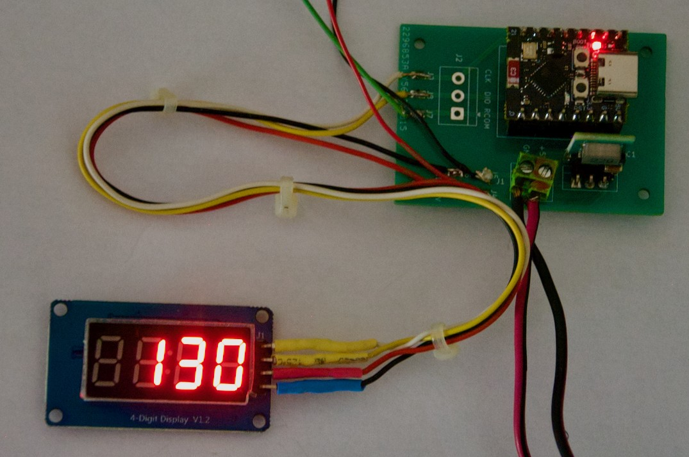
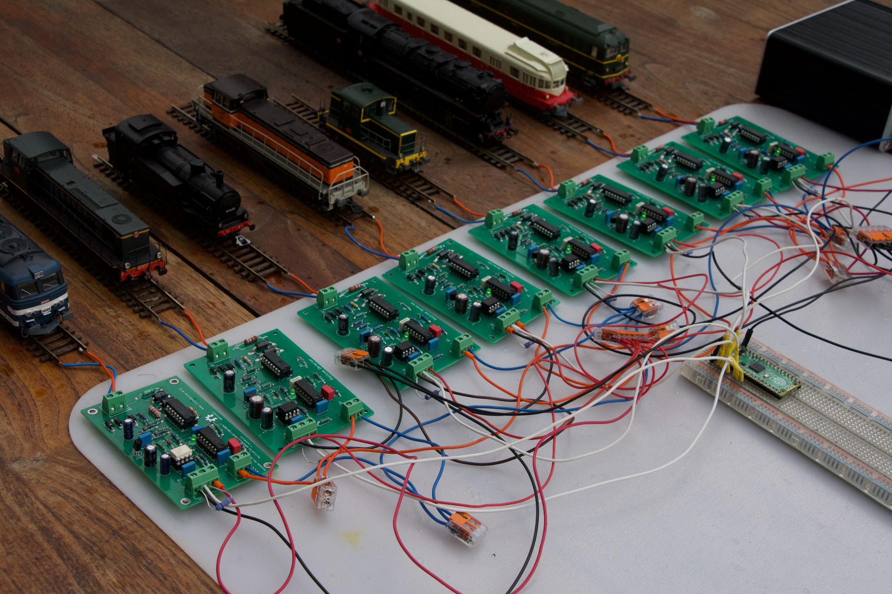

# DCC-LocoAddr

[Français](#français) | [English](#english)

---

# Français

## DCC-LocoAddr — lecture et affichage de l'adresse DCC des locomotives

Ce dépôt regroupe le matériel et le logiciel nécessaires pour lire l'adresse DCC d'une locomotive à partir de la communication bidirectionnelle sur la voie, puis l'exploiter ou l'afficher.

La méthode de transmission décrite par la NMRA S-9.3.2, associée au protocole DCC, est appelée « RailCom® ».

*RailCom® est une marque déposée de Lenz Elektronik GmbH. Ce projet n'est ni affilié à Lenz Elektronik ni approuvé par elle. Le nom n'est employé ici que pour désigner la méthode de communication bidirectionnelle décrite par la NMRA.*

```text
centrale DCC ──► détecteur LocoAddr v3.1 ──► canton isolé
                     │ OUT (UART 250 kbit/s, isolé)
                     ▼
                 ESP32 + DCC-LocoAddr
                     │
                     ├── adresse DCC
                     ├── sens de pose (option)
                     └── statistiques / diagnostic
                     │
                     ├── application personnelle
                     ├── LocoAddr Display
                     └── LocoAddr Mini Display
```

### Détecteur Railcom monté


### Mini Display ESP32-C3



### Display ESP32


## DCC-LocoAddr est une bibliothèque accessible directement à partir de votre environnement de travail, IDE Arduino ou PlatformIO.

À partir de la version **5.0.0**, le décodeur est une bibliothèque commune placée directement à la racine du dépôt, afin d'être compatible avec **Arduino Library Manager** et **PlatformIO Registry**.

## Arborescence

```text
DCC-LocoAddr/
├── library.properties          # manifeste Arduino
├── library.json                # manifeste PlatformIO
├── platformio.ini              # projet de développement PlatformIO
├── src/                        # bibliothèque DCC-LocoAddr
├── examples/                   # exemples Arduino
├── extras/tests/               # tests du décodeur sur PC
├── hardware/detector/          # détecteur LocoAddr v3.1
├── hardware/display/           # LocoAddr Display
├── hardware/display_min/       # LocoAddr Mini Display
├── scripts/                    # validation locale / release
└── .github/workflows/          # CI + publication PlatformIO
```

## Contenu matériel

| Dossier | Contenu |
|---|---|
| [`detector`](hardware/detector) | Détecteur **LocoAddr v3.1** : schéma, Fritzing, Gerbers, BOM, photos |
| [`display`](hardware/display) | **LocoAddr Display** : ESP32-WROOM-32 + afficheur 7 segments 4 digits |
| [`display_min`](hardware/display_min) | **LocoAddr Mini Display** : ESP32-C3 SuperMini + TM1637 |

Chaque dossier matériel contient ses propres schémas, fichiers de fabrication et documentation.

## Bibliothèque DCC-LocoAddr

La bibliothèque fournit :

- réception à 250 kbit/s sur ESP32, RP2040, RP2350 et Arduino Mega 2560 ;
- UART matériel sur ESP32 et Arduino Mega 2560 ; UART matériel ou PIO sur RP2040/RP2350 ;
- regroupement des octets par cutout ;
- décodage 4-out-of-8 ;
- traitement ADR1 / ADR2 ;
- adresses DCC courtes, longues et de consist ;
- validation d'une nouvelle adresse ;
- détection de perte ;
- lecture optionnelle du sens de pose de la locomotive sur les rails ;
- plusieurs détecteurs : jusqu'à 3 sur ESP32 et Arduino Mega 2560, 10 sur RP2040 et 14 sur RP2350 ;
- statistiques et callback de diagnostic.

Le coeur `LocoAddrDecoder` ne dépend ni d'Arduino ni du microcontrôleur et peut être testé sur PC.

Documentation détaillée : [`docs/LIBRARY.md`](docs/LIBRARY.md).

## Arduino IDE

Après publication dans Arduino Library Manager, rechercher :

```text
Menu > Gérer les bibliothèques > Rechercher : DCC-LocoAddr
```

Pour une installation manuelle de développement, cloner le dépôt directement dans le dossier `libraries` du sketchbook Arduino.

Les exemples apparaissent dans :

```text
Fichier > Exemples > DCC-LocoAddr
```

Pour AVR, un seul exemple est proposé : `examples/AVR/Mega/LocoAddr-3det/LocoAddr-3det.ino`.
Il utilise trois détecteurs indépendants sur `Serial1`, `Serial2` et `Serial3` de l'Arduino Mega 2560.

## PlatformIO

Le dépôt contient un `library.json` prêt pour PlatformIO Registry.

Avant publication dans le Registry, un projet externe peut déjà utiliser la bibliothèque depuis GitHub :

```ini
lib_deps =
    https://github.com/BOBILLEChristophe/DCC-LocoAddr.git
```

Le dépôt lui-même est aussi un projet PlatformIO de développement. Ouvrir simplement le dossier racine dans VS Code / PlatformIO.

Environnements disponibles :

```text
esp32-basic
esp32-multi
esp32-display
esp32c3-mini-display
rp2040-basic
rp2040-multi
rp2040-rocrail-loconet-wifi
rp2350-basic
rp2350-multi
avr-mega-3det
native-decoder
```

Exemples :

```bash
pio run -e esp32-basic
pio run -e esp32-display
pio run -e esp32c3-mini-display
pio run -e rp2040-basic
pio run -e rp2040-rocrail-loconet-wifi
pio run -e rp2350-basic
pio run -e avr-mega-3det
```

## Exemple vedette : identification automatique dans Rocrail avec Raspberry Pi Pico W

**DCC-LocoAddr** permet de réaliser une chaîne complète d’identification automatique des locomotives, depuis la voie jusqu’au logiciel de gestion du réseau.

Un **Raspberry Pi Pico W** centralise plusieurs détecteurs LocoAddr, identifie la locomotive présente sur chaque section de voie et transmet les informations en **Wi-Fi** à **Rocrail** au moyen de **LocoNet over TCP (LbServer)**.

La configuration fournie dans le dépôt utilise **4 détecteurs**, mais l’application réelle présentée ici fonctionne avec **8 détecteurs / 8 cantons sur un seul Raspberry Pi Pico W**.



### Ce que montre cette application

- jusqu’à **8 détecteurs LocoAddr** reliés à un seul Pico W ;
- identification de l’adresse DCC de la locomotive sur chaque canton ;
- communication **Wi-Fi**, sans liaison série avec le PC ;
- serveur **LocoNet over TCP / LbServer** intégré au Pico W ;
- transmission des identifications par messages LocoNet `OPC_MULTI_SENSE` ;
- intégration directe dans **Rocrail** ;
- utilisation également possible avec **JMRI** et potentiellement avec d’autres logiciels compatibles LocoNet over TCP.

➡️ [Documentation complète : Pico W + LocoNet + Rocrail](docs/integration/rocrail-loconet-pico-wifi.md)

➡️ [Exemple](examples/RP2040/Rocrail-LocoNet-Pico_WiFi/)

▶️ [Voir la démonstration vidéo](https://youtu.be/57QW2-mhkzE)

## Démarrage rapide

1. Monter un détecteur v3.1 en suivant [`hardware/detector/README.md`](hardware/detector/README.md). **U5 doit être un 74HC02 ou 74HCT02.**
2. Relier côté microcontrôleur : `5V µC` au 5 V, `GND µC` au GND, `VIO` à la tension logique du microcontrôleur (3,3 V pour ESP32/RP2040/RP2350, 5 V pour Arduino Mega 2560) et `OUT` à l'entrée RX choisie.
3. Compiler l'exemple correspondant à la carte, par exemple `examples/ESP32/LocoAddr/LocoAddr.ino` ou `examples/AVR/Mega/LocoAddr-3det/LocoAddr-3det.ino`.
4. La centrale ou le booster doit générer un cutout conforme à la communication bidirectionnelle DCC RailCom®.

## Développement et tests

Test du décodeur indépendant du matériel :

```bash
./scripts/test_decoder.sh
```

Vérification de la cohérence des numéros de version :

```bash
python3 scripts/check_version.py
```

La CI GitHub exécute également Arduino Lint, les tests natifs, les builds PlatformIO et la validation du paquet `library.json`.

## Licence

GPL-3.0 — © Christophe BOBILLE / Locoduino.

---

# English

## DCC-LocoAddr — reading and displaying locomotive DCC addresses

This repository contains the hardware and software required to read the DCC address of a locomotive from bidirectional communication on the track, and then use or display that information.

The transmission method described by NMRA S-9.3.2 and associated with the DCC protocol is called “RailCom®”.

*RailCom® is a registered trademark of Lenz Elektronik GmbH. This project is neither affiliated with nor endorsed by Lenz Elektronik. The name is used here only to refer to the bidirectional communication method described by the NMRA.*

```text
DCC command station ──► LocoAddr v3.1 detector ──► isolated track section
                              │ OUT (isolated UART, 250 kbit/s)
                              ▼
                        ESP32 + DCC-LocoAddr
                              │
                              ├── DCC address
                              ├── locomotive orientation (optional)
                              └── statistics / diagnostics
                              │
                              ├── custom application
                              ├── LocoAddr Display
                              └── LocoAddr Mini Display
```

### Assembled RailCom detector


### Mini Display ESP32-C3


### Display ESP32


## DCC-LocoAddr is a library that can be used directly from your development environment, Arduino IDE or PlatformIO.

Starting with version **5.0.0**, the decoder is provided as a common library located directly at the root of the repository, making it compatible with **Arduino Library Manager** and **PlatformIO Registry**.

## Repository structure

```text
DCC-LocoAddr/
├── library.properties          # Arduino manifest
├── library.json                # PlatformIO manifest
├── platformio.ini              # PlatformIO development project
├── src/                        # DCC-LocoAddr library
├── examples/                   # Arduino examples
├── extras/tests/               # decoder tests for PC
├── hardware/detector/          # LocoAddr v3.1 detector
├── hardware/display/           # LocoAddr Display
├── hardware/display_min/       # LocoAddr Mini Display
├── scripts/                    # local validation / release tools
└── .github/workflows/          # CI + PlatformIO publication
```

## Hardware

| Folder | Contents |
|---|---|
| [`detector`](hardware/detector) | **LocoAddr v3.1** detector: schematic, Fritzing files, Gerbers, BOM, photos |
| [`display`](hardware/display) | **LocoAddr Display**: ESP32-WROOM-32 + 4-digit 7-segment display |
| [`display_min`](hardware/display_min) | **LocoAddr Mini Display**: ESP32-C3 SuperMini + TM1637 |

Each hardware folder contains its own schematics, manufacturing files and documentation.

## DCC-LocoAddr library

The library provides:

- 250 kbit/s reception on ESP32, RP2040, RP2350 and Arduino Mega 2560;
- hardware UART on ESP32 and Arduino Mega 2560; hardware UART or PIO on RP2040/RP2350;
- grouping of received bytes by cutout;
- 4-out-of-8 decoding;
- ADR1 / ADR2 processing;
- short, long and consist DCC addresses;
- validation of newly detected addresses;
- locomotive loss detection;
- optional detection of locomotive orientation on the track;
- multiple detectors: up to 3 on ESP32 and Arduino Mega 2560, 10 on RP2040 and 14 on RP2350;
- statistics and diagnostic callback.

The `LocoAddrDecoder` core does not depend on Arduino or on any specific microcontroller and can be tested on a PC.

Detailed documentation: [`docs/LIBRARY.md`](docs/LIBRARY.md).

## Arduino IDE

After publication in Arduino Library Manager, search for:

```text
Menu > Manage Libraries > Search: DCC-LocoAddr
```

For a manual development installation, clone the repository directly into the `libraries` folder of your Arduino sketchbook.

The examples are available under:

```text
File > Examples > DCC-LocoAddr
```

For AVR, a single example is provided: `examples/AVR/Mega/LocoAddr-3det/LocoAddr-3det.ino`.
It uses three independent detectors on `Serial1`, `Serial2` and `Serial3` of the Arduino Mega 2560.

## PlatformIO

The repository contains a `library.json` manifest ready for PlatformIO Registry.

Before publication in the Registry, an external project can already use the library directly from GitHub:

```ini
lib_deps =
    https://github.com/BOBILLEChristophe/DCC-LocoAddr.git
```

The repository itself is also a PlatformIO development project. Simply open the repository root folder in VS Code / PlatformIO.

Available environments:

```text
esp32-basic
esp32-multi
esp32-display
esp32c3-mini-display
rp2040-basic
rp2040-multi
rp2040-rocrail-loconet-wifi
rp2350-basic
rp2350-multi
avr-mega-3det
native-decoder
```

Examples:

```bash
pio run -e esp32-basic
pio run -e esp32-display
pio run -e esp32c3-mini-display
pio run -e rp2040-basic
pio run -e rp2040-rocrail-loconet-wifi
pio run -e rp2350-basic
pio run -e avr-mega-3det
```

## Featured example: automatic locomotive identification in Rocrail with Raspberry Pi Pico W

**DCC-LocoAddr** can be used to build a complete automatic locomotive identification chain, from the track to the layout control software.

A **Raspberry Pi Pico W** collects data from several LocoAddr detectors, identifies the locomotive present on each isolated track section and sends the information over **Wi-Fi** to **Rocrail** using **LocoNet over TCP (LbServer)**.

The supplied example is configured for **4 detectors**, while the real application shown here operates with **8 detectors / 8 blocks on a single Raspberry Pi Pico W**.


### What this application demonstrates

- up to **8 LocoAddr detectors** connected to one Pico W;
- DCC locomotive address identification on each block;
- **Wi-Fi** communication with no serial connection to the computer;
- an embedded **LocoNet over TCP / LbServer** server;
- locomotive identification using LocoNet `OPC_MULTI_SENSE` messages;
- direct integration with **Rocrail**;
- use with **JMRI** and potentially other LocoNet over TCP compatible software.

➡️ [Complete documentation: Pico W + LocoNet + Rocrail](docs/integration/rocrail-loconet-pico-wifi.md)

➡️ [Example](examples/RP2040/Rocrail-LocoNet-Pico_WiFi/)

▶️ [Watch the demonstration video](https://youtu.be/57QW2-mhkzE)

## Quick start

1. Assemble a v3.1 detector by following [`hardware/detector/README.md`](hardware/detector/README.md). **U5 must be a 74HC02 or 74HCT02.**
2. On the microcontroller side, connect `5V µC` to 5 V, `GND µC` to GND, `VIO` to the logic voltage of the microcontroller (3.3 V for ESP32/RP2040/RP2350, 5 V for Arduino Mega 2560), and `OUT` to the selected RX input.
3. Compile the example matching the board, for example `examples/ESP32/LocoAddr/LocoAddr.ino` or `examples/AVR/Mega/LocoAddr-3det/LocoAddr-3det.ino`.
4. The command station or booster must generate a cutout compatible with RailCom® DCC bidirectional communication.

## Development and testing

Run the hardware-independent decoder test:

```bash
./scripts/test_decoder.sh
```

Check version number consistency:

```bash
python3 scripts/check_version.py
```

GitHub CI also runs Arduino Lint, native tests, PlatformIO builds and validation of the `library.json` package.

## License

GPL-3.0 — © Christophe BOBILLE / Locoduino.