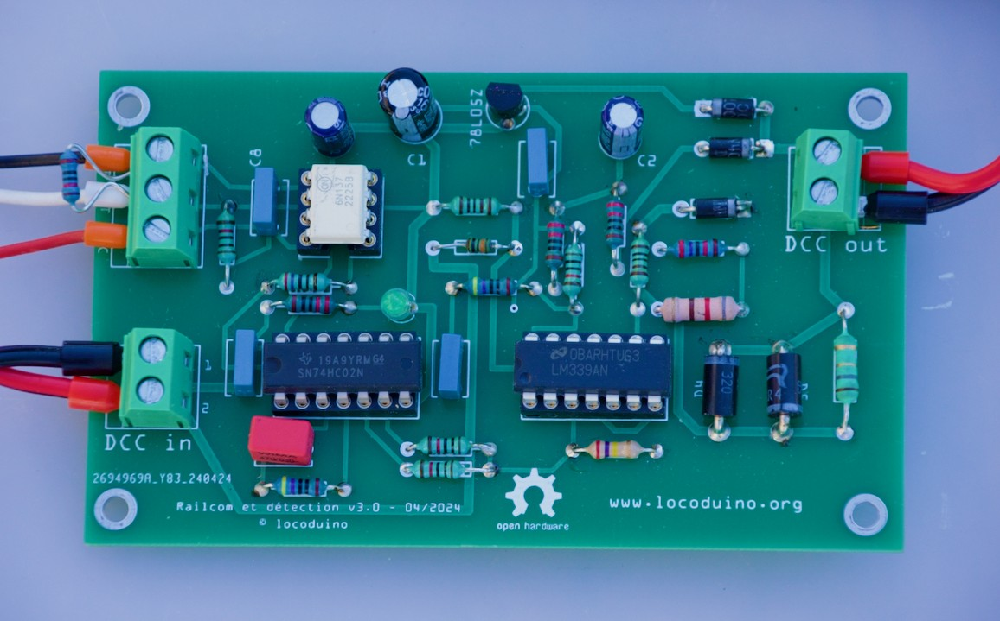

# DCC-LocoAddr — lecture et affichage de l'adresse DCC des locomotives

Ce dépôt regroupe le matériel et le logiciel nécessaires pour lire l'adresse DCC d'une locomotive à partir de la communication bidirectionnelle sur la voie, puis l'exploiter ou l'afficher.

La méthode de transmission décrite par la NMRA S-9.3.2, associée au protocole DCC, est appelée « RailCom® ».

*RailCom® est une marque déposée de Lenz Elektronik GmbH. Ce projet n'est ni affilié à Lenz Elektronik ni approuvé par elle. Le nom n'est employé ici que pour désigner la méthode de communication bidirectionnelle décrite par la NMRA.*

```text
centrale DCC ──► détecteur LocoAddr v3.1 ──► canton isolé
                     │ OUT (UART 250 kbit/s, isolé)
                     ▼
                 ESP32 + DCC-LocoAddr
                     │
                     ├── adresse DCC
                     ├── sens de pose (option)
                     └── statistiques / diagnostic
                     │
                     ├── application personnelle
                     ├── LocoAddr Display
                     └── LocoAddr Mini Display
```
### Détecteur Railcom monté



## DCC-LocoAddr est une bibliothèque accessible directement à partir de votre environnement de travail, IDE Arduino ou PlatformIO.

À partir de la version **5.0.0**, le décodeur est une bibliothèque commune placée directement à la racine du dépôt, afin d'être compatible avec **Arduino Library Manager** et **PlatformIO Registry**.

## Arborescence

```text
DCC-LocoAddr/
├── library.properties          # manifeste Arduino
├── library.json                # manifeste PlatformIO
├── platformio.ini              # projet de développement PlatformIO
├── src/                        # bibliothèque DCC-LocoAddr
├── examples/                   # exemples Arduino
├── extras/tests/               # tests du décodeur sur PC
├── hardware/detector/          # détecteur LocoAddr v3.1
├── hardware/display/           # LocoAddr Display
├── hardware/display_min/       # LocoAddr Mini Display
├── scripts/                    # validation locale / release
└── .github/workflows/          # CI + publication PlatformIO
```

## Contenu matériel

| Dossier | Contenu |
|---|---|
| [`detector`](hardware/detector) | Détecteur **LocoAddr v3.1** : schéma, Fritzing, Gerbers, BOM, photos |
| [`display`](hardware/display) | **LocoAddr Display** : ESP32-WROOM-32 + afficheur 7 segments 4 digits |
| [`display_min`](hardware/display_min) | **LocoAddr Mini Display** : ESP32-C3 SuperMini + TM1637 |

Chaque dossier matériel contient ses propres schémas, fichiers de fabrication et documentation.

## Bibliothèque DCC-LocoAddr

La bibliothèque fournit :

- réception à 250 kbit/s sur ESP32, RP2040 et RP2350 ;
- UART matériel sur ESP32 ; UART matériel ou PIO sur RP2040/RP2350 ;
- regroupement des octets par cutout ;
- décodage 4-out-of-8 ;
- traitement ADR1 / ADR2 ;
- adresses DCC courtes, longues et de consist ;
- validation d'une nouvelle adresse ;
- détection de perte ;
- lecture optionnelle du sens de pose de la locomotive sur les rails ;
- plusieurs détecteurs : jusqu'à 3 sur ESP32, 10 sur RP2040 et 14 sur RP2350 ;
- statistiques et callback de diagnostic.

Le coeur `LocoAddrDecoder` ne dépend ni d'Arduino ni du microcontrôleur et peut être testé sur PC.

Documentation détaillée : [`docs/LIBRARY.md`](docs/LIBRARY.md).

## Arduino IDE

Après publication dans Arduino Library Manager, rechercher :

```text
Menu > Gérer les bibliothèques > Rechercher : DCC-LocoAddr
```

Pour une installation manuelle de développement, cloner le dépôt directement dans le dossier `libraries` du sketchbook Arduino.

Les exemples apparaissent dans :

```text
Fichier > Exemples > DCC-LocoAddr
```

## PlatformIO

Le dépôt contient un `library.json` prêt pour PlatformIO Registry.

Avant publication dans le Registry, un projet externe peut déjà utiliser la bibliothèque depuis GitHub :

```ini
lib_deps =
    https://github.com/BOBILLEChristophe/DCC-LocoAddr.git
```

Le dépôt lui-même est aussi un projet PlatformIO de développement. Ouvrir simplement le dossier racine dans VS Code / PlatformIO.

Environnements disponibles :

```text
esp32-basic
esp32-multi
esp32-display
esp32c3-mini-display
rp2040-basic
rp2040-multi
rp2350-basic
rp2350-multi
native-decoder
```

Exemples :

```bash
pio run -e esp32-basic
pio run -e esp32-display
pio run -e esp32c3-mini-display
pio run -e rp2040-basic
pio run -e rp2350-basic
```

## Démarrage rapide

1. Monter un détecteur v3.1 en suivant [`hardware/detector/README.md`](hardware/detector/README.md). **U5 doit être un 74HC02 ou 74HCT02.**
2. Relier côté microcontrôleur : `5V µC` au 5 V, `GND µC` au GND, `VIO` au 3,3 V d'un ESP32 et `OUT` à l'entrée RX choisie.
3. Compiler `examples/ESP32/LocoAddr/LocoAddr.ino` ou l'un des afficheurs.
4. La centrale ou le booster doit générer un cutout conforme à la communication bidirectionnelle DCC RailCom®.

## Développement et tests

Test du décodeur indépendant du matériel :

```bash
./scripts/test_decoder.sh
```

Vérification de la cohérence des numéros de version :

```bash
python3 scripts/check_version.py
```

La CI GitHub exécute également Arduino Lint, les tests natifs, les builds PlatformIO et la validation du paquet `library.json`.


## Licence

GPL-3.0 — © Christophe BOBILLE / Locoduino.
