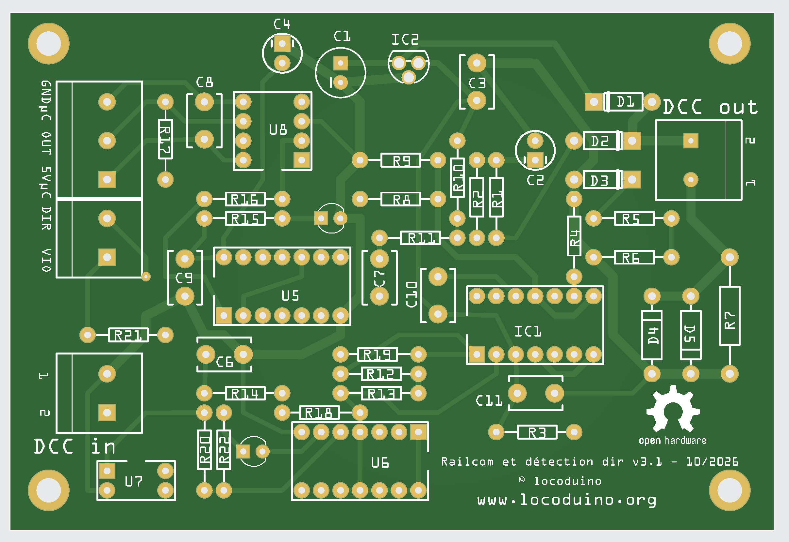
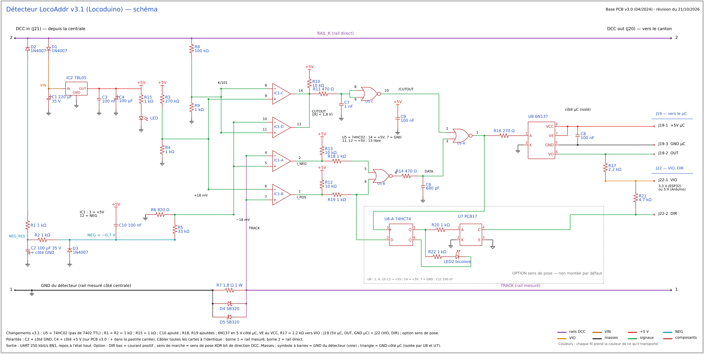

# Détecteur LocoAddr v3.1

Carte qui s'insère entre la centrale DCC et un canton isolé. Pendant le *cutout* RailCom®, elle lit le courant renvoyé par le décodeur de la locomotive et le restitue, isolé de la voie, sous forme d'un signal série (UART 250 kbit/s, 8N1) qu'un microcontrôleur décode. La bibliothèque [`DCC-LocoAddr`](..) en extrait l'adresse de la locomotive.

En option, la carte indique aussi le **sens de pose** de la locomotive sur la voie (sortie DIR).

---

## Contenu du dossier

| Dossier | Contenu |
|---|---|
| `schema/` | `locoaddr_detector_v3.1_schematic.pdf` et `.png`, le schéma complet, option comprise |
| `fritzing/` | `locoaddr_detector_v3.1.fzz`, le fichier Fritzing du circuit imprimé, sur lequel on monte ou non l'option |
| `GERBER/` | `locoaddr_detector_v3.1_GERBER.zip`, les fichiers de fabrication, vérifiés contre le fichier Fritzing |
| `BOM/` | `locoaddr_detector_BOM.xlsx` et `.pdf`, la nomenclature : composants de base et composants de l'option |
| `photos/` | `locoaddr_detector_v3.1_pcb.png`, le rendu du circuit imprimé v3.1 ; `locoaddr_detector_v3.0_photo.jpg`, une carte v3.0 (04/2024) montée |

---

## Fonctionnement

- **Alimentation :** la carte s'alimente sur la voie. D1 et C1 redressent le signal DCC, le 78L05 (IC2) fournit le +5 V. D2, R1, R2, C2 et D3 créent un petit rail négatif d'environ −0,7 V pour le comparateur LM339.
- **Mesure du courant :** le courant du canton traverse le shunt R7 (1,8 Ω), protégé par les Schottky D4 et D5 montées tête-bêche. Les comparateurs IC1-A et IC1-B détectent un courant positif ou négatif au-delà de ±18 mV, soit environ 10 mA.
- **Fenêtre du cutout :** IC1-C et IC1-D surveillent la tension de voie divisée par 101 (R8/R9). Le cutout est reconnu quand elle reste inférieure à 1,8 V environ.
- **Mise en forme :** les portes NOR du 74HC02 (U5) ne laissent passer les impulsions de courant que pendant le cutout.
- **Isolation :** l'optocoupleur 6N137 (U8) transmet le signal côté microcontrôleur. Sa sortie OUT est tirée vers VIO par R17 (2,2 kΩ) : au repos, elle est à l'état haut.
- **Option sens de pose :** la bascule 74HC74 (U6) mémorise le signe du courant au début du cutout. Le PC817 (U7) transmet cette information isolée sur DIR. La LED bicolore LED2 l'affiche.

---

## Points d'attention

> ⚠️ **U5 doit être un 74HC02, ou un 74HCT02, et pas un 7402 TTL.** Une entrée TTL fournit environ 1,6 mA quand elle est au niveau bas. Avec les résistances de 470 Ω et de 1 kΩ en série sur les entrées, la tension monte au-dessus du seuil bas, et la carte ne fonctionne pas, ou seulement par moments. L'ancienne BOM indiquait SN7402N : c'est probablement la cause des cartes qui ne fonctionnaient pas.

- **VIO doit recevoir la tension logique du microcontrôleur :** 3,3 V pour un ESP32, 5 V pour un Arduino 5 V. Sans VIO, la sortie OUT ne remonte pas.
- **Polarités :** le + de C2 va côté GND, car il est sur le rail négatif. Le + de C4 va côté +5 V.
- **Câblage des rails :** il faut câbler toutes les cartes de la même façon : borne 1 sur le rail mesuré, borne 2 sur le rail direct, pour DCC in comme pour DCC out. C'est indispensable pour que l'option sens de pose donne le même résultat d'un canton à l'autre.
- **D4 et D5 :** les trous font 1,3 mm, pour les pattes des SB320 ou 1N540x.
- **IC2 :** le fichier Fritzing utilise une empreinte TO-92 corrigée. L'ancienne empreinte générait un perçage non métallisé de 1,35 mm sur les broches du 78L05.

---

## Connexions

| Borne | Broche | Signal | Relier à |
|---|---|---|---|
| J21 « DCC in » | 1, 2 | rail mesuré, rail direct | la centrale |
| J20 « DCC out » | 1, 2 | rail mesuré, rail direct | le canton isolé |
| J19 | 1 | 5V µC | le 5 V du microcontrôleur : il alimente le côté sortie du 6N137 |
| J19 | 2 | OUT | l'entrée RX de l'UART du microcontrôleur |
| J19 | 3 | GND µC | la masse du microcontrôleur, isolée de la voie |
| J22 | 1 | VIO | le 3,3 V d'un ESP32, ou le 5 V d'un Arduino 5 V |
| J22 | 2 | DIR | une entrée du microcontrôleur, seulement avec l'option sens de pose |

Avec l'option, DIR est à l'état bas quand le courant est positif. Le sens de marche de la locomotive se déduit du sens de pose et du bit de direction DCC (OU exclusif).

### Avec un ancien détecteur v3.0

La sortie de la carte v3.0 est tirée vers 5 V par R17 (10 kΩ), et il n'y a pas de VIO. Pour un ESP32, on ajoute **une résistance de 20 kΩ entre RX et GND** côté microcontrôleur : le niveau haut descend à 3,3 V environ.

---

## Montage : base ou option

La même carte sert aux deux versions. Pour la version de base, on ne soude pas les composants de l'option : U6, U7, C11, R20, R21, R22 et LED2. La BOM les signale dans la colonne « Option ». La version de base compte 42 composants, l'option en ajoute 7.

> L'option sens de pose n'a pas encore été essayée sur une carte réelle.

---

## Changements depuis la v3.0

- U5 en **74HC02**, au lieu du 7402 TTL.
- R1 = R2 = 1 kΩ, et R15 = 1 kΩ pour la LED témoin.
- C10 ajouté pour le découplage du LM339. R18 et R19 ajoutées en série sur les entrées de U5-B.
- 6N137 alimenté en 5 V côté microcontrôleur, VE relié à VCC, et R17 = 2,2 kΩ tirée vers VIO au lieu du 5 V.
- Sorties sur J19 (5V µC, OUT, GND µC) et J22 (VIO, DIR).
- Ajout de l'option sens de pose.

---

## Logiciel

Pour lire l'adresse des locomotives avec un ESP32, voir la bibliothèque [`DCC-LocoAddr`](..) et ses exemples. Pour l'afficher, voir [`display`](../display) et [`display_min`](../display_min).

Il faut une centrale DCC qui génère le cutout RailCom.

---

© Christophe BOBILLE – Locoduino – licence GPL-3.0

---

*RailCom® est une marque déposée de Lenz Elektronik GmbH. Ce projet n'est ni affilié à Lenz Elektronik ni approuvé par elle. Le nom RailCom n'y est employé que pour désigner la norme de communication bidirectionnelle (NMRA S-9.3.2, RCN-217) que le matériel et le logiciel respectent.*
