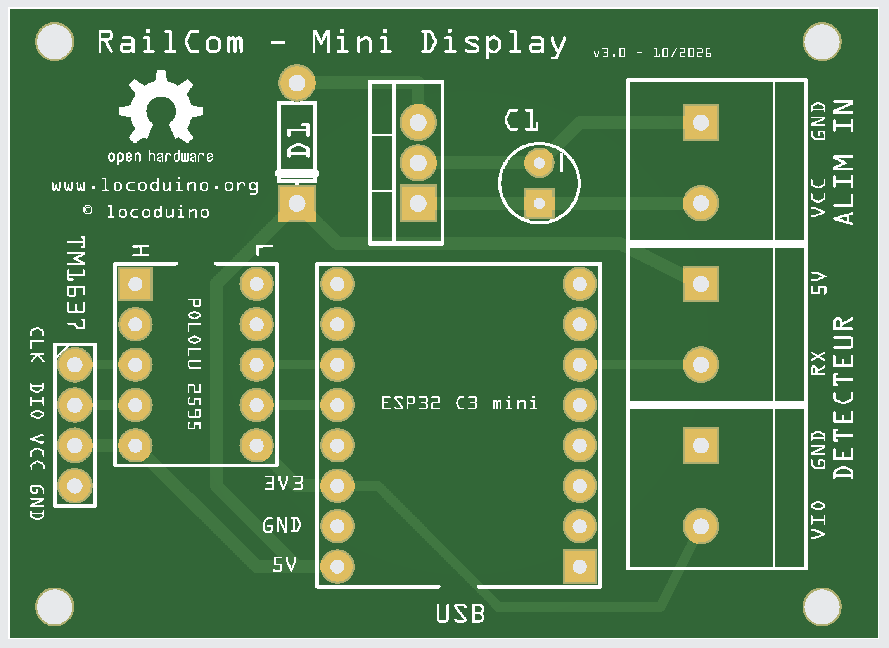
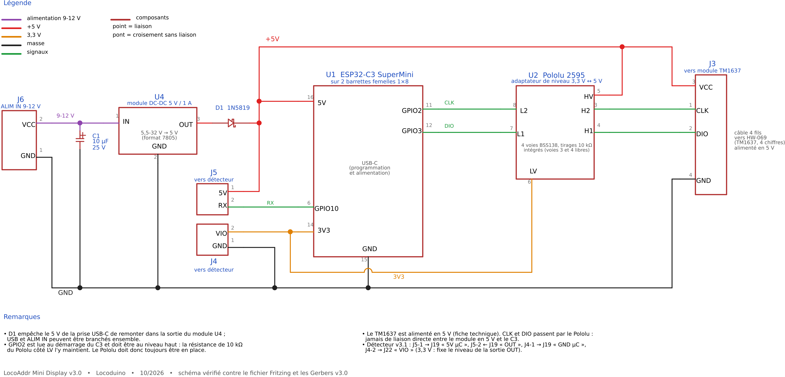

# LocoAddr Mini Display

Version réduite et économique de LocoAddr Display. Elle affiche l'adresse DCC d'une locomotive posée sur un bout de voie isolé, avec :

- un **ESP32-C3 SuperMini**, petit, peu coûteux, avec prise USB-C ;
- un **module afficheur TM1637** de 4 chiffres, prêt à brancher : 4 fils, sans transistor ni résistance ;
- un détecteur Locoduino LocoAddr **carte v3.1**.



---

## Contenu du dossier

| Dossier | Contenu |
|---|---|
| `LocoAddr-Display-min/` | le programme Arduino `LocoAddr-Display-min.ino` |
| `schema/` | `locoaddr_display_min_v3.0_schematic.pdf` et `.png`, le schéma électronique |
| `fritzing/` | `locoaddr_display_min_v3.0.fzz`, le fichier Fritzing du circuit imprimé « LocoAddr - Mini Display v3.0 » |
| `GERBER/` | `locoaddr_display_min_v3.0_GERBER.zip`, les fichiers de fabrication (54,8 × 39,8 mm), vérifiés contre le schéma : 10 équipotentielles conformes |
| `BOM/` | `locoaddr_display_min_v3.0_BOM.xlsx` et `.pdf`, la nomenclature |
| `photos/` | `locoaddr_display_min_v3.0_pcb.png`, le rendu du circuit imprimé ; `locoaddr_display_min_prototype.jpg`, le prototype câblé (implantation antérieure à la v3.0) ; `esp32_c3_supermini_brochage.png`, le brochage du SuperMini |
| `doc/` | `regulateur_dc-dc_5V_1A.pdf`, la fiche du module abaisseur U4 |



---

## Matériel (circuit imprimé Mini Display v3.0)

| Repère | Quantité | Composant | Remarque |
|---|---|---|---|
| U1 | 1 | ESP32-C3 SuperMini | sur 2 barrettes femelles 1×8, USB-C vers le bord |
| U2 | 1 | Pololu 2595, adaptateur de niveau 4 voies | sur 2 barrettes femelles 1×5. Rangée L côté C3. **Obligatoire** : il tient aussi GPIO2 au niveau haut au démarrage |
| — | 1 | Module afficheur TM1637 4 chiffres (HW-069) | déporté, câble 4 fils |
| J3 | 1 | Barrette mâle 4 broches, pas 2,54 | 1 CLK, 2 DIO, 3 VCC, 4 GND, dans le même ordre que le module |
| J4, J5, J6 | 3 | Bornier à vis 2 points, pas 5,08 | J5 : 5V, RX ; J4 : GND, VIO ; J6 : ALIM IN (GND, VCC) |
| U4 | 1 | Module abaisseur 5,5-32 V → 5 V / 1 A, au format 7805 | empreinte TO-220 du 7805. Vérifier l'ordre entrée, masse, sortie sur la sérigraphie du module (fiche dans `doc/`) |
| C1 | 1 | Condensateur chimique 10 µF, 25 V minimum (alimentation 9-12 V) | à l'entrée du module U4, + côté VCC |
| D1 | 1 | Diode Schottky **1N5819** | évite le retour de courant vers l'USB. Pas de 1N4001/1N4007, qui feraient chuter la tension de 0,7 à 1 V |
| — | 2 | Barrette femelle 1×8, pas 2,54 | support de U1 (rangées écartées de 15,24 mm) |
| — | 2 | Barrette femelle 1×5, pas 2,54 | support de U2 (rangées écartées de 7,62 mm) |
| — | 4 | Fil Dupont femelle-femelle | liaison J3 ↔ module TM1637 (ou nappe 4 fils) |
| — | 1 | Circuit imprimé Mini Display v3.0 | |

## Alimentation

- **Par la prise USB-C du SuperMini :** pour les essais et le téléversement.
- **Par ALIM IN (J6), de 9 à 12 V :** le module U4 fournit le 5 V, puis D1 l'amène au rail 5 V de la carte.
- **Les deux en même temps :** c'est possible, D1 empêche le module de renvoyer du courant vers le PC.

## Câblage

| De | Vers | Remarque |
|---|---|---|
| Détecteur J19 « 5V µC » | J5-1 « 5V » | alimente le 6N137 du détecteur |
| Détecteur J19 « OUT » | J5-2 « RX », vers GPIO10 | entrée RailCom |
| Détecteur J19 « GND µC » | J4-1 « GND » | |
| Détecteur J22 « VIO » | J4-2 « VIO », relié au 3V3 du C3 | indispensable |
| TM1637 CLK | GPIO2, par l'adaptateur de niveau (voie 2) | GPIO2 est lue au démarrage du C3 et doit être au niveau haut : la résistance de 10 kΩ du Pololu côté LV l'y maintient |
| TM1637 DIO | GPIO3, par l'adaptateur de niveau (voie 1) | |
| TM1637 VCC | **5V** du C3 | voir l'adaptateur de niveau ci-dessous |
| TM1637 GND | GND | |

### Alimentation du module TM1637 : 5 V et adaptateur de niveau

La fiche technique du TM1637 impose une alimentation de **4,5 à 5,5 V**, et un niveau haut d'au moins **0,7 × VDD**, soit 3,5 V, sur CLK et DIO. Le module tire lui-même CLK et DIO vers son alimentation, par deux résistances de 10 kΩ. Or l'ESP32-C3 ne sort que 3,3 V, et ses broches n'admettent pas plus de 3,6 V.

Le montage retenu alimente donc le module en **5 V**, avec un **adaptateur de niveau à 2 voies** entre le C3 et le module :

```
              3V3
               │
        ┌──────┴───────┐
      10 kΩ            │ grille
        │         ┌────┴────┐
GPIO2 ──┴──── S ──┤ BSS138  ├── D ──── CLK du module (tiré à 5 V par le module)
                  └─────────┘
GPIO3 : même montage avec le second BSS138 ──────── DIO du module
```

| Repère | Quantité | Composant |
|---|---|---|
| Q1, Q2 | 2 | MOSFET canal N **BSS138**, boîtier SOT-23 |
| R1, R2 | 2 | 10 kΩ, tirage côté 3,3 V |

Grille au 3V3, source côté C3, drain côté module. Le montage fonctionne dans les deux sens, ce qui est indispensable pour DIO : le TM1637 y renvoie un accusé de réception. **Solution retenue pour le circuit imprimé :** le module **Pololu 2595** (« Logic Level Shifter, 4-Channel, Bidirectional »). Il contient 4 voies à MOSFET canal N, avec deux résistances de tirage de 10 kΩ par voie, une de chaque côté. Il mesure 13 × 10 mm, avec des broches au pas de 2,54 mm. Seules 2 voies servent, et R1 et R2 deviennent inutiles.

| Broche du Pololu 2595 | Relier à |
|---|---|
| LV | 3V3 du C3 |
| HV | 5V |
| L2 / H2 | GPIO2 / CLK du TM1637 |
| L1 / H1 | GPIO3 / DIO du TM1637 |
| L3, L4, H3, H4 | libres |

Disposition des broches, lue au dos du module : deux rangées de 5, au pas de 2,54 mm, écartées de 7,62 mm. Chaque broche L fait face à la broche H de même numéro.

```
 rangée basse tension    rangée haute tension
        L4  ●              ●  H4
        L3  ●              ●  H3
        L2  ●              ●  H2
        L1  ●              ●  H1
        LV  ●              ●  HV
          (vue du dos du module)
```

Vu de dessus, côté composants, les deux rangées sont inversées : L à droite, H à gauche.

Le Pololu 2595 n'a **pas de broche GND** : les masses du C3 et du module TM1637 doivent être reliées entre elles, ce qui est le cas sur le circuit imprimé. HV doit toujours être supérieur à LV.

Le schéma et le premier tableau de cette section décrivent le même montage en composants séparés, si l'on préfère souder les BSS138 soi-même. Il faut éviter les BS170 et 2N7000 en boîtier TO-92 : leur tension de seuil peut atteindre 3 V, trop proche des 3,3 V disponibles.

> ⚠️ **Mises en garde**
> - **Ne jamais relier directement CLK et DIO d'un module alimenté en 5 V au C3.** Les résistances de tirage du module amèneraient 5 V sur les broches du C3, au-delà de son maximum de 3,6 V.
> - **Alimenter le module en 3,3 V, sans adaptateur,** est possible pour un essai, mais c'est hors fiche technique (4,5 V minimum). Ça ne convient qu'aux **modules à LED rouges**, avec une luminosité plus faible. Il faut l'essayer module par module, car le comportement varie selon l'origine de la puce. Les modules **bleus ou blancs**, dont les LED demandent environ 3 V, ne fonctionnent pas correctement en 3,3 V.

**Avec un ancien détecteur v3.0 :** il n'y a pas de fil VIO. On ajoute une résistance de 20 kΩ entre GPIO10 et GND, comme pour LocoAddr Display.

---

## Installation du programme

1. Installer la bibliothèque **DCC-LocoAddr** : installer **DCC-LocoAddr** depuis le gestionnaire de bibliothèques Arduino (après publication), ou cloner ce dépôt dans le dossier des bibliothèques Arduino.
2. Installer la bibliothèque **TM1637** d'Avishay Orpaz, depuis le gestionnaire de bibliothèques de l'IDE.
3. Ouvrir `LocoAddr-Display-min/LocoAddr-Display-min.ino`.
4. Choisir la carte **ESP32C3 Dev Module** et régler **USB CDC On Boot : Enabled**, pour que les messages passent par la prise USB-C.
5. Téléverser le programme.

| Réglage | Défaut | Rôle |
|---|---|---|
| `LOG_LEVEL` | `LOG_INFO` | Messages : `LOG_NONE`, `LOG_ERROR`, `LOG_INFO`, `LOG_VERBOSE`, `LOG_DEBUG` |
| `BRIGHTNESS` | 7 | Luminosité, de 0 à 7 |
| `SHOW_DASHES_WHEN_EMPTY` | false | Sans locomotive : afficheur éteint, ou `----` |
| `DETECTOR_RX_PIN`, `TM1637_CLK_PIN`, `TM1637_DIO_PIN` | 10, 2, 3 | Broches |

Au démarrage, l'afficheur montre `8888` pendant une demi-seconde pour tester tous les segments. En cas d'échec de l'initialisation du détecteur, il affiche `Err`.

---

## Changements par rapport à la version d'octobre 2025

- **Bibliothèque :** le décodage passe par la bibliothèque commune DCC-LocoAddr. La bibliothèque RingBuf n'est plus nécessaire.
- **Validation de l'adresse :** il faut 5 lectures identiques au lieu de 20, la locomotive est donc reconnue plus vite. Les adresses de consist et les adresses longues sont décodées correctement.
- **Sans locomotive :** l'afficheur s'éteint, au lieu d'afficher `0`.
- **Afficheur :** il n'est mis à jour qu'au changement d'adresse, plus toutes les 100 ms.

---

© Christophe BOBILLE – Locoduino – licence GPL-3.0

---

*RailCom® est une marque déposée de Lenz Elektronik GmbH. Ce projet n'est ni affilié à Lenz Elektronik ni approuvé par elle. Le nom RailCom n'y est employé que pour désigner la norme de communication bidirectionnelle (NMRA S-9.3.2, RCN-217) que le matériel et le logiciel respectent.*
