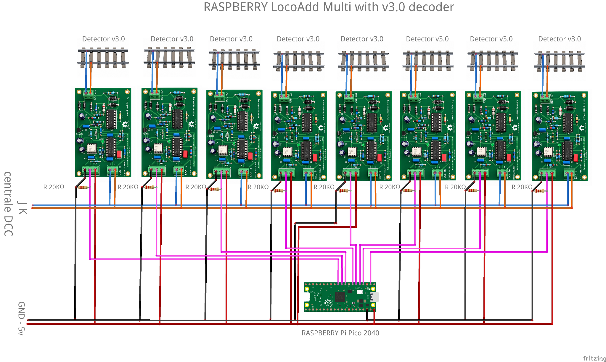
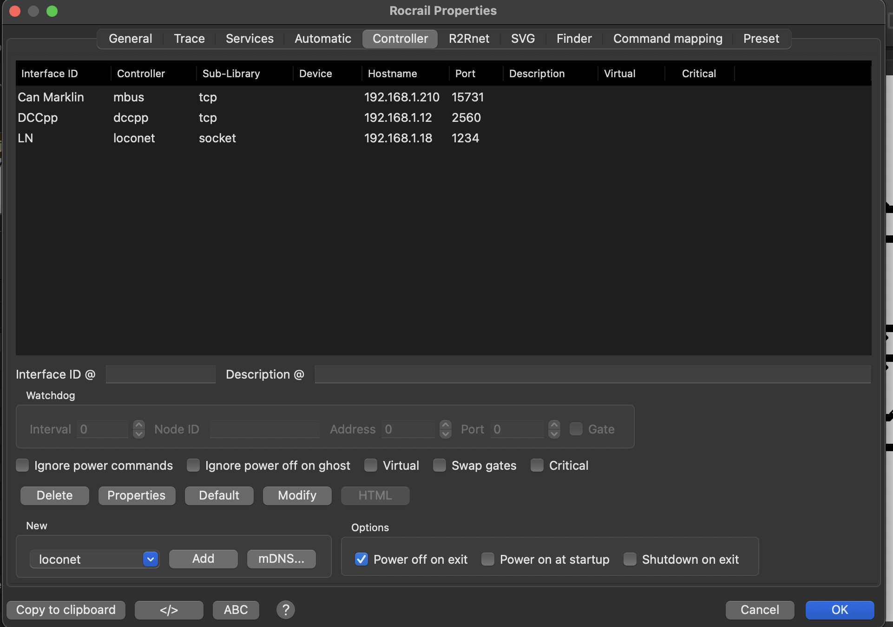
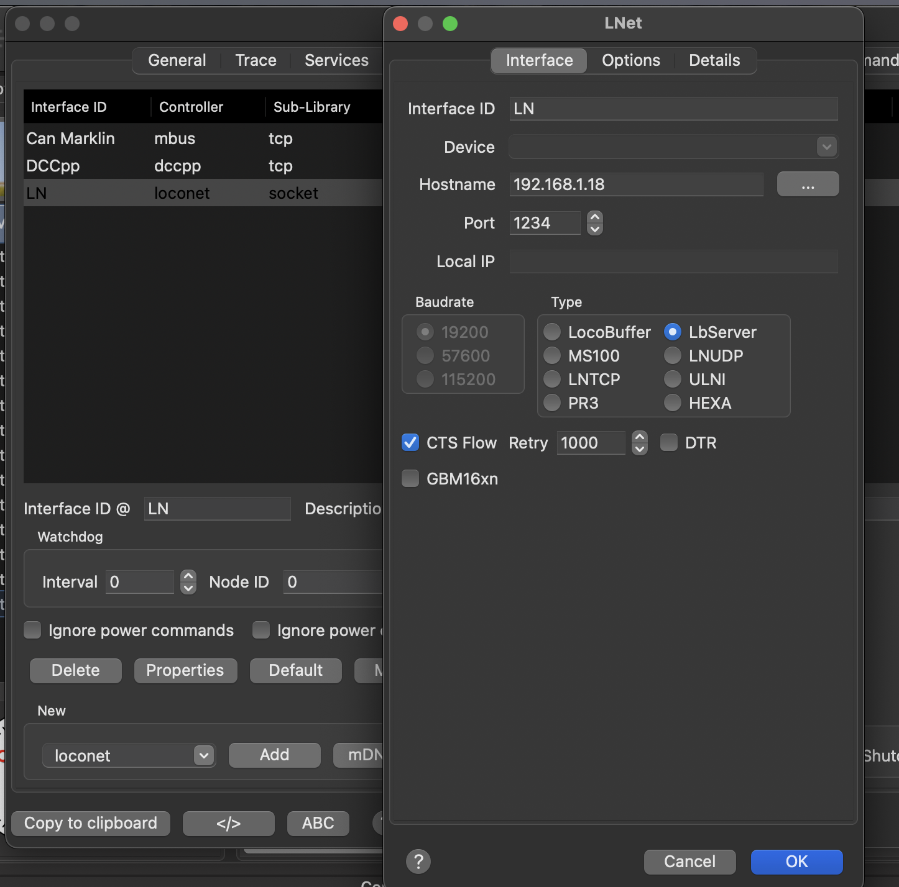
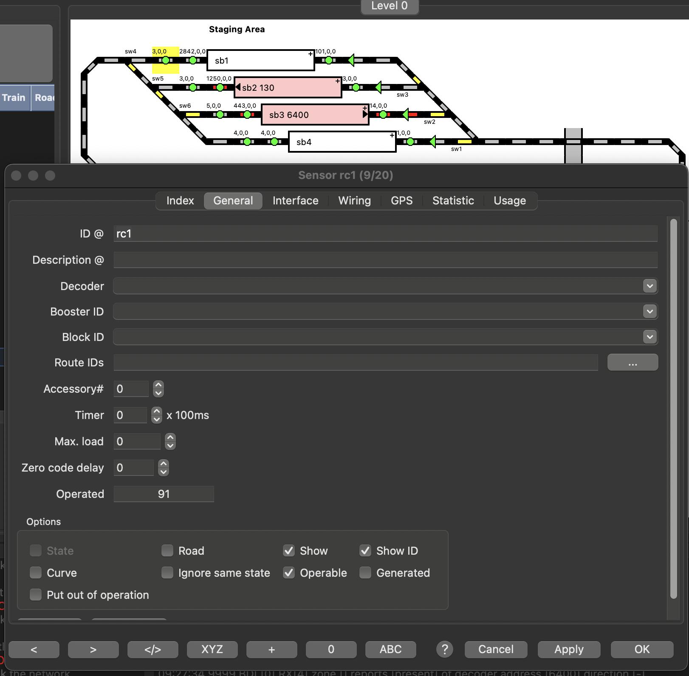
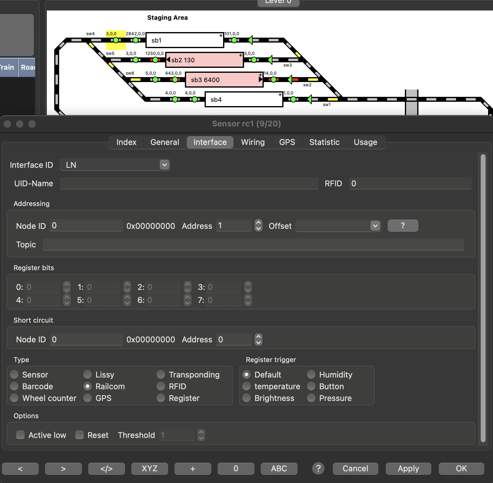
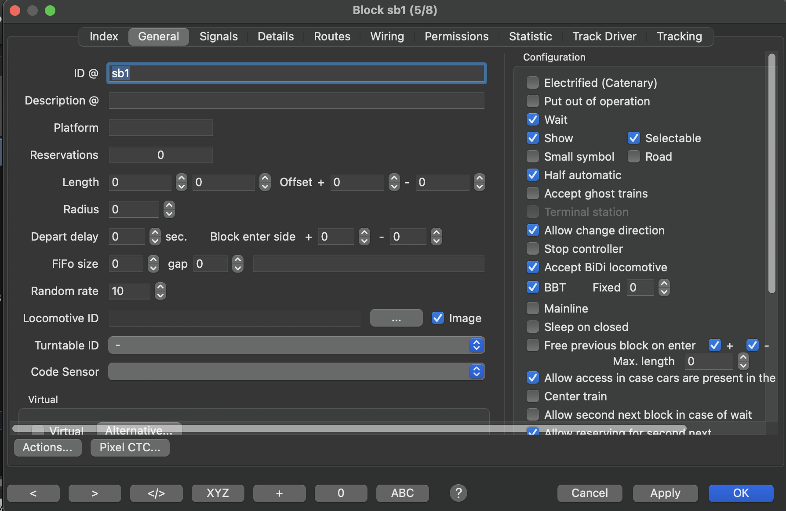
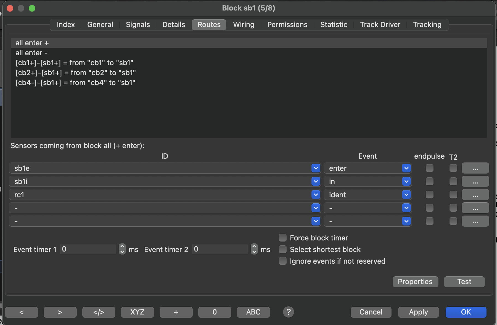
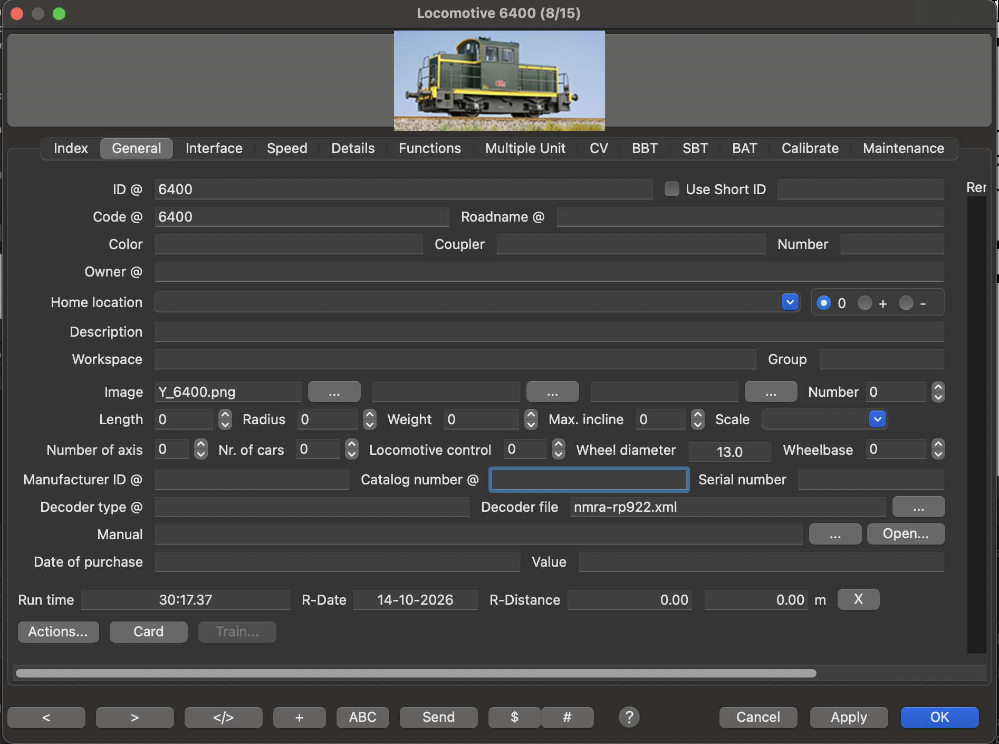
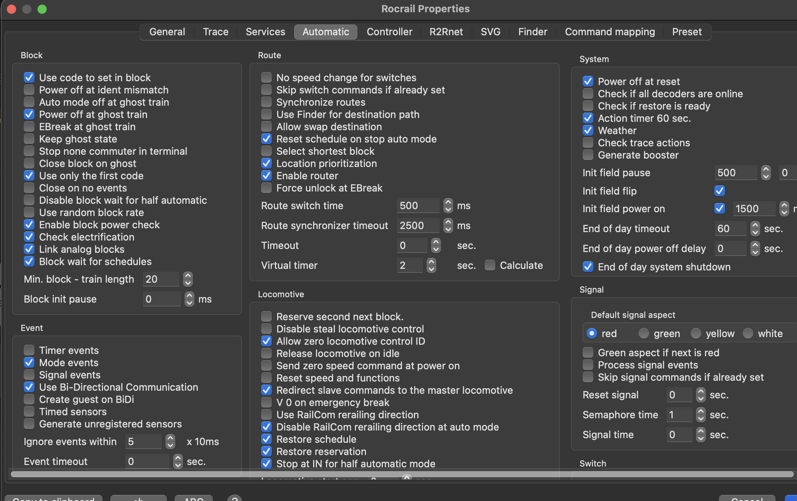

# LocoAddr + Raspberry Pi Pico W + LocoNet over TCP

## Identification des locomotives dans Rocrail sur 4 cantons (jusqu'à 8 cantons possibles par Raspberry Pi Pico W)

Cet exemple montre une chaîne complète d'identification des locomotives, depuis la voie jusqu'au logiciel de gestion du réseau.

Quatre détecteurs **LocoAddr** sont raccordés à quatre sections de voie isolées. Chaque détecteur lit, pendant le cutout DCC, l'adresse renvoyée par le décodeur compatible RailCom® présent sur sa section.

Un **Raspberry Pi Pico W** lit simultanément les quatre détecteurs et transmet les changements de présence et d'identité des locomotives sur le réseau Wi-Fi. Il se comporte comme un serveur **LocoNet over TCP** de type **LbServer** et envoie des messages de transpondage LocoNet® `OPC_MULTI_SENSE`.

Rocrail peut ainsi connaître non seulement l'occupation du bloc, mais également l'adresse de la locomotive présente dans celui-ci. L'utilisation de LocoNet over TCP rend aussi l'exemple exploitable avec **JMRI** et potentiellement avec d'autres gestionnaires de réseau compatibles.

> La configuration documentée ici utilise **4 cantons**. Le principe peut être étendu jusqu'à **8 cantons par Raspberry Pi Pico W**.

---

## 1. Architecture générale

```text
Voie DCC / cutout RailCom
        │
        ├── Détecteur LocoAddr 1 ── GP1 ──┐
        ├── Détecteur LocoAddr 2 ── GP2 ──┤
        ├── Détecteur LocoAddr 3 ── GP3 ──┤ Raspberry Pi Pico W
        └── Détecteur LocoAddr 4 ── GP4 ──┘
                                             │
                                             │ Wi-Fi / TCP 1234
                                             ▼
                                    LocoNet over TCP / LbServer
                                             │
                                             ▼
                                      Rocrail / JMRI
```

Le principe est volontairement simple : **un détecteur = une section de voie = un canton = un capteur Rocrail**.

---

## 2. Exemple fourni

L'exemple se trouve dans :

```text
examples/RP2040/Rocrail-LocoNet-Pico_WiFi/
```

Il contient :

```text
Rocrail-LocoNet-Pico_WiFi.ino
LbServer.h
LbServer.cpp
Transponder.h
Transponder.cpp
README.md
```

La configuration fournie utilise quatre détecteurs :

```cpp
constexpr uint8_t NB_DETECTORS = 4;
```

Les broches d'entrée sont définies dans `RX_PINS`. Avec la configuration par défaut :

| Détecteur | OUT du détecteur | Canton | Capteur Rocrail |
|---|---:|---:|---|
| 1 | GP1 | 1 | rc1 |
| 2 | GP2 | 2 | rc2 |
| 3 | GP3 | 3 | rc3 |
| 4 | GP4 | 4 | rc4 |

La bibliothèque `DCC-LocoAddr` choisit automatiquement la ressource de réception disponible (UART matériel ou PIO).

---

## 3. Organisation logicielle

### `Rocrail-LocoNet-Pico_WiFi.ino`

Le programme principal assure :

- la création des lecteurs `LocoAddrReader` ;
- la connexion Wi-Fi ;
- le démarrage du serveur LbServer ;
- la lecture de l'adresse présente dans chaque canton ;
- la transmission des changements au module `Transponder`.

Dans `loop()` :

```cpp
for (uint8_t i = 0; i < NB_DETECTORS; ++i)
{
    transponder.setCanton(i + 1, detectors[i]->address());
}
```

La bibliothèque DCC-LocoAddr effectue déjà la validation de l'adresse et la détection de disparition. Aucun filtrage supplémentaire n'est nécessaire ici.

### `LbServer`

`LbServer.h` et `LbServer.cpp` implémentent le serveur **LocoNet over TCP**.

Le port par défaut est :

```cpp
constexpr uint16_t LBSERVER_PORT = 1234;
```

Les échanges sont textuels, par exemple :

```text
SEND 82 7D
SENT OK
RECEIVE D0 20 00 32 00 3D
```

Le serveur gère également la reconnexion et le keepalive TCP.

### `Transponder`

`Transponder.h` et `Transponder.cpp` mémorisent la locomotive présente dans chaque canton et génèrent les messages LocoNet `OPC_MULTI_SENSE` (`0xD0`).

Lors d'un changement :

1. l'ancienne locomotive est déclarée absente ;
2. la nouvelle locomotive est déclarée présente.

Si l'adresse ne change pas, aucun message n'est envoyé.

Lorsqu'un client LbServer se reconnecte, `resendAll()` renvoie l'état des cantons occupés afin de resynchroniser Rocrail.

---

## 4. Matériel nécessaire

Pour la configuration présentée :

- 1 Raspberry Pi Pico W ou Pico 2 W ;
- 4 détecteurs LocoAddr ;
- 4 sections de voie isolées ;
- une centrale ou un booster DCC générant le cutout RailCom ;
- des décodeurs avec RailCom activé ;
- un réseau Wi-Fi local ;
- Rocrail sur le poste de supervision.

---

## 5. Câblage

### Connexions communes

| Détecteur LocoAddr | Raspberry Pi Pico W |
|---|---|
| J19 – 5V µC | VBUS / 5 V |
| J19 – GND µC | GND |
| J22 – VIO | 3V3(OUT) |

**VIO doit rester à 3,3 V avec le Pico W.**

### Sorties série de l'exemple

| Détecteur | J19 – OUT |
|---|---|
| 1 | GP1 |
| 2 | GP2 |
| 3 | GP3 |
| 4 | GP4 |

Le programme contient une liste plus longue de broches afin de permettre l'extension de l'exemple. Les broches utilisées par les fonctions internes ou par le Wi-Fi du Pico W doivent être évitées.

---

## 6. Schéma de principe multi-détecteurs



Cette illustration montre le principe général de raccordement de plusieurs détecteurs à un Raspberry Pi Pico. Elle représente **8 détecteurs** et une version antérieure du matériel ; elle doit donc être lue comme un **schéma de principe multi-détecteurs**, et non comme le câblage exact de l'exemple à quatre cantons.

---

## 7. Configuration Wi-Fi

Adapter dans le sketch :

```cpp
const char *WIFI_SSID = "mon_reseau";
const char *WIFI_PASSWORD = "mon_mot_de_passe";
```

Le Pico peut utiliser une adresse obtenue par DHCP ou une adresse IP fixe. Pour une installation permanente, une réservation DHCP dans la box est généralement le choix le plus simple.

L'adresse IP est affichée sur le moniteur série au démarrage.

---

## 8. Configuration Rocrail

### 8.1 Ajouter une centrale LocoNet

Dans **Rocrail Properties → Controller**, ajouter un contrôleur `loconet`.



Ouvrir ses propriétés et choisir :

- **Type** : `LbServer` ;
- **Hostname** : adresse IP du Pico W ;
- **Port** : `1234` ;
- **Interface ID** : `LN`.



Il est préférable de réserver l'adresse IP du Pico W afin qu'elle ne change pas.

### 8.2 Ajouter un capteur par détecteur

Créer un capteur pour chaque canton, par exemple `rc1` pour le bloc `sb1`.



Dans l'onglet **Interface** :

- **Interface ID** : `LN` ;
- **Node ID** : `0` ;
- **Address** : `1` ;
- **Type** : **Railcom**.



Pour les suivants :

| Capteur | Node ID | Address | Type |
|---|---:|---:|---|
| rc1 | 0 | 1 | Railcom |
| rc2 | 0 | 2 | Railcom |
| rc3 | 0 | 3 | Railcom |
| rc4 | 0 | 4 | Railcom |

### 8.3 Associer le capteur au bloc

Dans les propriétés du bloc, la configuration générale peut rester celle utilisée habituellement sur le réseau.



Dans l'onglet **Routes** :

1. sélectionner `all enter +` ;
2. ajouter le capteur correspondant (`rc1` pour `sb1`) ;
3. choisir l'événement **ident** ;
4. faire de même pour `all enter -`.



Correspondance de l'exemple :

```text
rc1 → sb1
rc2 → sb2
rc3 → sb3
rc4 → sb4
```

Lors des essais en mode manuel, l'option **Accept BiDi locomotive** n'a pas été nécessaire. En mode automatique, son activation peut être nécessaire selon la configuration Rocrail utilisée.

### 8.4 Renseigner le code de chaque locomotive

Dans la fiche de chaque locomotive, onglet **General**, renseigner son adresse DCC dans le champ **Code**.



Exemple :

```text
Adresse DCC : 6400
Code        : 6400
```

C'est ce champ que Rocrail compare à l'adresse reçue.

### 8.5 Options automatiques

Dans **Rocrail Properties → Automatic**, activer :

- **Use code to set in block** ;
- **Use Bi-Directional Communication**.



---

## 9. RailCom côté DCC

La centrale ou le booster doit générer le **cutout** nécessaire à la communication bidirectionnelle DCC.

RailCom doit aussi être activé dans les décodeurs. Chez de nombreux décodeurs, cela implique notamment :

- le bit 3 de la CV29 ;
- le canal 1 dans la CV28.

Le détecteur LocoAddr utilise le canal 1 pour récupérer l'adresse DCC.

---

## 10. Compatibilité JMRI

Le transport réseau n'est pas spécifique à Rocrail : le Pico expose un serveur **LocoNet over TCP / LbServer**.

Cette architecture permet aussi une utilisation avec **JMRI**. D'autres logiciels compatibles LocoNet over TCP peuvent probablement être utilisés de la même manière.

Les réglages propres à JMRI et aux autres logiciels ne sont pas détaillés dans cet exemple.

---

## 11. Vidéo de démonstration

Une vidéo montre le fonctionnement complet avec remontée des adresses et actualisation des blocs dans Rocrail :

https://youtu.be/57QW2-mhkzE

---

## 12. Résumé

```text
RailCom
   ↓
Détecteur LocoAddr
   ↓
Raspberry Pi Pico W
   ↓
LocoNet over TCP / Wi-Fi
   ↓
Rocrail / JMRI
```

Cet exemple illustre une chaîne complète, depuis l'information physique remontée par la locomotive jusqu'à son identification automatique dans le logiciel de gestion du réseau.

RailCom® est une marque déposée de Lenz Elektronik GmbH.
LocoNet® est une marque de Digitrax, Inc.
