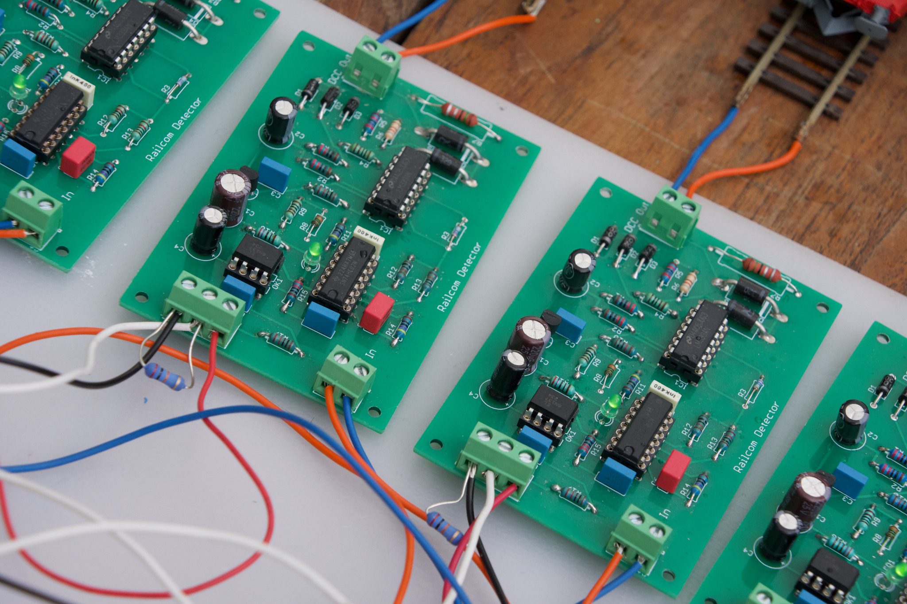
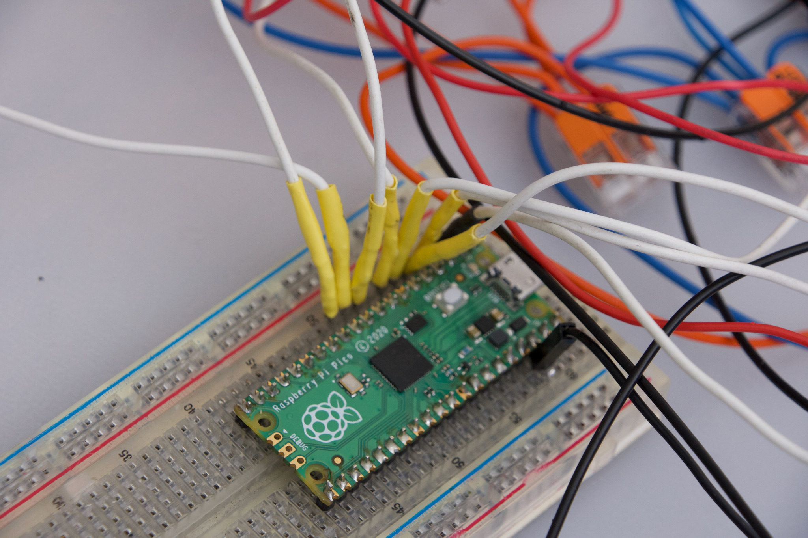

# LocoAddr + Raspberry Pi Pico W + LocoNet over TCP

## Identification automatique des locomotives dans Rocrail
### Jusqu’à 8 cantons avec un seul Raspberry Pi Pico W

Cet exemple présente une **application complète de DCC-LocoAddr**.

Plusieurs détecteurs LocoAddr sont raccordés à des sections de voie isolées. Le **Raspberry Pi Pico W** lit en permanence les adresses DCC détectées sur ces sections puis transmet les changements de présence et d’identité à **Rocrail** par Wi-Fi.

Le Pico W se comporte pour cela comme un serveur **LocoNet over TCP (LbServer)** et génère les messages LocoNet `OPC_MULTI_SENSE` utilisés pour l’identification des locomotives.

La configuration du programme fourni utilise **4 détecteurs** :

`NB_DETECTORS = 4`

Le même principe permet d’utiliser jusqu’à **8 détecteurs / 8 cantons avec un seul Raspberry Pi Pico W**. Le montage réel illustré dans cette documentation utilise huit détecteurs simultanément.

## Principe

La chaîne complète est :

`Voie DCC → détecteur LocoAddr → Pico W → Wi-Fi → LocoNet over TCP → Rocrail`

Chaque détecteur correspond à une section de voie et à un canton Rocrail.

Lorsqu’une locomotive entre dans une section, DCC-LocoAddr détermine son adresse. Le Pico W associe cette adresse au canton correspondant et envoie l’information à Rocrail. Lorsqu’elle quitte la section, un message d’absence est envoyé.

## Schéma de principe multi-détecteurs

Le schéma ci-dessous illustre l’architecture générale de l’application lorsqu’un **Raspberry Pi Pico W** centralise jusqu’à **8 détecteurs LocoAddr**.

Ce schéma représente le principe suivant :

- une **section de voie isolée** par canton ;
- un **détecteur LocoAddr** par section ;
- une **entrée dédiée du Pico W** par détecteur ;
- un seul **serveur LocoNet over TCP** pour transmettre les identifications au logiciel.

> Ce schéma doit être compris comme un **schéma de principe multi-détecteurs**.
>
> Le programme fourni dans cet exemple est configuré par défaut pour **4 détecteurs**, mais l’architecture présentée ici permet d’aller jusqu’à **8 cantons avec un seul Pico W**.

## Points clés

- jusqu’à **8 détecteurs** utilisés simultanément ;
- liaison réseau **Wi-Fi**, sans connexion série avec le PC ;
- serveur **LbServer** directement intégré au Pico W ;
- transmission des identifications par messages `OPC_MULTI_SENSE` ;
- resynchronisation des cantons occupés après reconnexion de Rocrail ;
- intégration directe dans **Rocrail** ;
- utilisation également possible avec **JMRI**.

## Câblage par défaut de l’exemple fourni

| Détecteur | Entrée Pico W | Canton | Capteur Rocrail |
|---|---:|---:|---|
| 1 | GP1 | 1 | rc1 |
| 2 | GP2 | 2 | rc2 |
| 3 | GP3 | 3 | rc3 |
| 4 | GP4 | 4 | rc4 |

La liste `RX_PINS` permet d’étendre cette application jusqu’à 8 détecteurs.

## Fichiers

- `Rocrail-LocoNet-Pico_WiFi.ino` : détecteurs, Wi-Fi et intégration générale ;
- `LbServer.h` / `LbServer.cpp` : serveur LocoNet over TCP ;
- `Transponder.h` / `Transponder.cpp` : gestion des cantons et messages `OPC_MULTI_SENSE`.

## Raspberry Pi Pico W

Le Pico W assure simultanément la lecture des détecteurs, le suivi de la locomotive présente dans chaque canton, la connexion Wi-Fi, le serveur TCP sur le port 1234 et la transmission des événements LocoNet.

## Configuration Rocrail

Dans Rocrail, le Pico W est déclaré comme contrôleur **LocoNet**, de type **LbServer**.

Chaque détecteur correspond à un capteur Rocrail :

- Interface ID : `LN`
- Node ID : `0`
- Address : numéro du canton
- Type : **Railcom**

Le champ `Code` de chaque locomotive doit contenir son adresse DCC afin que Rocrail puisse faire le lien entre l’identification reçue et la locomotive correspondante.

La procédure complète, illustrée par les captures d’écran Rocrail, est disponible dans la documentation détaillée :

➡️ [Documentation complète : Pico W + LocoNet + Rocrail](../../../docs/integration/rocrail-loconet-pico-wifi.md)

## Démonstration vidéo

La démonstration montre la remontée des adresses DCC de plusieurs locomotives et leur identification automatique dans Rocrail au fur et à mesure de leur présence sur les différentes sections de voie.

▶️ **[Voir la démonstration vidéo](https://youtu.be/57QW2-mhkzE)**

RailCom® est une marque déposée de Lenz Elektronik GmbH.

LocoNet® est une marque de Digitrax, Inc.
