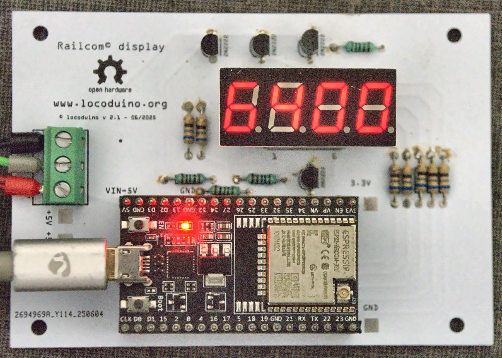
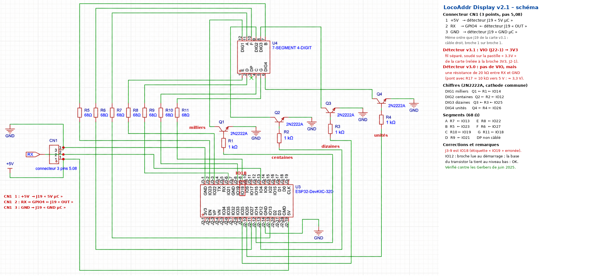

# LocoAddr Display

Utilitaire qui affiche l'adresse DCC d'une locomotive posée sur un bout de voie isolé. L'afficheur 4 chiffres 7 segments est piloté par un **ESP32-WROOM-32**, relié à un détecteur Locoduino LocoAddr (**carte v3.1**).

Vidéo de démonstration : https://youtu.be/wCtRoU4dOLk

---

## Contenu du dossier

| Dossier | Contenu |
|---|---|
| [`examples/ESP32/LocoAddr-Display/`](../../examples/ESP32/LocoAddr-Display/) | le programme Arduino `LocoAddr-Display.ino` |
| `schema/` | `locoaddr_display_v2.1_schematic.png`, le schéma annoté et vérifié contre les Gerbers, et `locoaddr_display_v2.1_schematic_original.png`, le schéma d'origine |
| `fritzing/` | `locoaddr_display_v2.1.fzz`, le fichier Fritzing du circuit imprimé v2.1 (06/2025) |
| `GERBER/` | `locoaddr_display_v2.1_GERBER.zip`, les fichiers de fabrication du circuit imprimé (100 × 70 mm) |
| `BOM/` | `locoaddr_display_v2.1_BOM.xlsx` et `.pdf`, la nomenclature |
| `photos/` | `locoaddr_display_photo.jpg`, la carte en fonctionnement, et `locoaddr_display_v2.1_pcb.png`, le rendu du circuit imprimé |

---

## Matériel

| Repère | Quantité | Composant |
|---|---|---|
| U3 | 1 | Carte de développement **ESP32-DevKitC** (ESP32-WROOM-32, 38 broches), sur 2 barrettes femelles 1×19 |
| U4 | 1 | Afficheur LED 7 segments, 4 chiffres, **LFD039AUE-102A** (cathode commune), sur 2 barrettes femelles 1×6 |
| Q1 à Q4 | 4 | Transistor **2N2222A** (TO-92), pour la sélection des chiffres |
| R1 à R4 | 4 | Résistance **1 kΩ**, sur la base des transistors |
| R5 à R11 | 7 | Résistance **68 Ω**, sur les segments |
| CN1 | 1 | Bornier à vis 3 points, pas 5,08 : 1 +5V, 2 RX, 3 GND |
| — | 1 | Fil souple entre la pastille « 3.3V » et VIO du détecteur (voir plus bas) |
| — | 1 | Détecteur LocoAddr v3.1, voir le dossier [`detector`](../detector) |

---

## Brochage de l'ESP32

| Fonction | GPIO | Broche de la DevKitC |
|---|---|---|
| Entrée RailCom (CN1-2) | 4 | J3-13 |
| Chiffres : milliers, centaines, dizaines, unités | 14, 12, 25, 26 | J2-12, J2-13, J2-9, J2-10 |
| Segments A, B, C, D, E, F, G | 13, 23, 19, 21, 22, 27, 18 | J2-15, J3-2, J3-8, J3-6, J3-3, J2-11, J3-9 |

Le schéma d'origine étiquette J3-9 « IO19 ». C'est en réalité **IO18**, comme sur la carte et dans le programme.

## Liaison avec le détecteur v3.1

| Afficheur | Détecteur v3.1 | Remarque |
|---|---|---|
| CN1-1 +5V | J19 « 5V µC » | alimente le 6N137 du détecteur |
| CN1-2 RX | J19 « OUT » | arrive sur GPIO4 |
| CN1-3 GND | J19 « GND µC » | |
| pastille « 3.3V » de la carte | J22-1 « VIO » | **fil séparé**, indispensable |

CN1 et J19 ont le même ordre de broches : le câble 3 fils est droit, broche 1 sur broche 1.

**VIO doit être relié au 3,3 V.** Sur la carte v3.1, la sortie OUT est tirée vers VIO. Sans VIO, le signal ne remonte pas correctement. CN1 n'amène pas le 3,3 V : on soude un fil sur la pastille marquée **« 3.3V »** de la carte, à droite de la broche 3V3 de l'ESP32, et on le relie à J22-1 du détecteur. La carte a aussi des pastilles « +5V » et « GND » libres.

### Avec un ancien détecteur v3.0

La sortie du détecteur v3.0 est tirée vers 5 V par R17 (10 kΩ). Ce niveau dépasse ce qu'admet l'ESP32. Il suffit d'ajouter **une résistance de 20 kΩ entre RX et GND** côté afficheur. Elle forme un pont diviseur avec R17, et le niveau haut descend à 3,3 V environ (5 V × 20 / 30). Avec un détecteur v3.0, il n'y a pas de fil VIO.

---

## Installation du programme

1. Installer la bibliothèque **DCC-LocoAddr** : installer **DCC-LocoAddr** depuis le gestionnaire de bibliothèques Arduino (après publication), ou cloner ce dépôt dans le dossier des bibliothèques Arduino.
2. Ouvrir [`examples/ESP32/LocoAddr-Display/LocoAddr-Display.ino`](../../examples/ESP32/LocoAddr-Display/LocoAddr-Display.ino).
3. Choisir la carte *ESP32 Dev Module*, puis téléverser le programme.

Les réglages sont regroupés en tête du programme :

| Réglage | Défaut | Rôle |
|---|---|---|
| `LOG_LEVEL` | `LOG_INFO` | Messages sur le moniteur série, du plus discret au plus bavard : `LOG_NONE`, `LOG_ERROR`, `LOG_INFO`, `LOG_VERBOSE`, `LOG_DEBUG` |
| `DIGIT_ON_MS` | 2 | Durée d'allumage de chaque chiffre, en ms |

---

## Affichage

| Situation | Afficheur |
|---|---|
| Aucune locomotive | éteint |
| Locomotive présente | son adresse, de 1 à 9999, sans zéros à gauche |

---

## Changements par rapport à la version 4.7

- **Bibliothèque :** le décodage RailCom passe par la bibliothèque commune DCC-LocoAddr. Il n'y a plus de copie du code dans le programme.
- **Rafraîchissement :** 125 Hz au lieu de 50 Hz, chaque chiffre restant allumé 2 ms au lieu de 5 ms. L'afficheur ne scintille plus.
- **Adresses de consist :** elles sont correctes, le bit de sens n'est plus compté dans l'adresse.
- **Messages :** leur quantité se règle avec `LOG_LEVEL`.

---

© Christophe BOBILLE – Locoduino – licence GPL-3.0

---

*RailCom® est une marque déposée de Lenz Elektronik GmbH. Ce projet n'est ni affilié à Lenz Elektronik ni approuvé par elle. Le nom RailCom n'y est employé que pour désigner la norme de communication bidirectionnelle (NMRA S-9.3.2, RCN-217) que le matériel et le logiciel respectent.*
